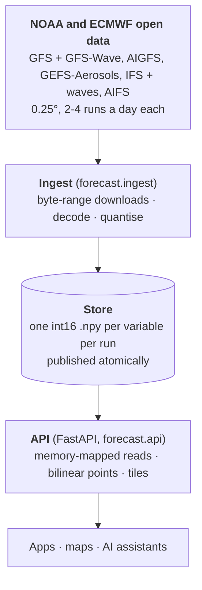

<p align="center">
  <a href="https://4shadow.io">
    <picture>
      <source media="(prefers-color-scheme: dark)" srcset="docs/images/wordmark-dark.svg" />
      
    </picture>
  </a>
</p>

<h3 align="center">An open weather forecast API for any point on Earth</h3>

<p align="center">
  Point forecasts, map tiles, raw gridded fields, place search, early-warning checks and an MCP server for AI assistants,<br />
  16 days ahead, from NOAA's GFS, GFS-Wave and AIGFS (AI), ECMWF's IFS and AIFS (AI), and NOAA's GEFS-Aerosols air quality, all open data. The engine behind <a href="https://4shadow.io">4Shadow</a>.
</p>

<p align="center">
  <a href="https://github.com/similie/4Shadow-api/actions/workflows/ci.yml"></a>
  <a href="LICENSE"></a>
  
  <a href="docs/deploy.md"></a>
</p>

<p align="center">
  <a href="https://4shadow.io/signup"><b>Get a free API key</b></a> ·
  <a href="https://4shadow.io/docs">API docs</a> ·
  <a href="https://4shadow.io/map">Live map</a> ·
  <a href="https://github.com/similie/4Shadow-js">JS SDK and map</a> ·
  <a href="docs/deploy.md">Run your own</a>
</p>

<p align="center">
  <a href="https://github.com/similie/4Shadow-js"></a><br />
  <sub>Wind from this API's raw fields, drawn on the GPU by the open-source <a href="https://github.com/similie/4Shadow-js">4Shadow-js</a> map.</sub>
</p>

---

## What it does

- **A forecast for any coordinates or any place name.** Current conditions, an hourly timeline and local-day summaries for 45 variables: temperature, dew point and humidity, wind and gusts, pressure, rain, cloud (total, low, middle and high), solar radiation, CAPE, simulated radar, precipitable water, visibility, snow depth, freezing level, frozen precipitation and freezing rain, soil moisture and temperature, wind and wind power at 100 m, and at sea wave height, period and direction, wind sea and swell. Hourly to 5 days, then 3-hourly to 16 days.
- **Heat, fire and comfort indices.** Feels-like temperature, heat index, wet-bulb temperature, vapour pressure deficit and the Fosberg fire weather index, computed from the forecast with published formulas. They work everywhere the other variables do, including maps and early warnings.
- **Four weather models to compare.** NOAA's physics-based GFS and its AI model AIGFS, built on Google DeepMind's GraphCast (`/v2/aigfs/forecast`), and ECMWF's IFS, the European model (`/v2/ifs/forecast`), and its AI model AIFS (`/v2/aifs/forecast`). The same variable ids and units in each, so where they agree you can trust the forecast more.
- **Air quality.** PM2.5, PM10, dust, and haze from dust and smoke, from NOAA's GEFS-Aerosols, every 3 hours to 5 days (`/v2/aerosols/forecast`).
- **Ocean currents and tides.** Surface current speed and direction, tidal currents included, and tide heights with the times of high and low water, hourly to 10 days, from the Copernicus Marine Service's global ocean forecast (`/v2/ocean/forecast`; needs a free Copernicus Marine account).
- **Satellite imagery.** The geostationary satellites' pictures of the globe (GOES, Meteosat, Himawari), blended by NOAA each hour: infrared cloud-top temperature day and night, water vapour and visible, at 0.1°, the last 24 hours (`/v2/satellite/...`).
- **Place search that never leaves the server.** Names to coordinates and coordinates to the nearest town, in any language GeoNames records, from a local SQLite index of every village on Earth.
- **Map tiles and raw fields.** XYZ PNG tiles with fixed colour scales, and the numbers behind them as compact int16 grids for WebGL maps, particles and analysis (wind for the whole globe at 0.5° is about 1 MB).
- **Early-warning checks.** Give an area and conditions ("50 mm of rain in 24 hours over a quarter of this district") and get back when the latest run meets them, with peaks and coverage. The 4Shadow site turns these answers into webhooks and emails.
- **An MCP server.** AI assistants can ask for forecasts, hourly tables and places through the [Model Context Protocol](https://modelcontextprotocol.io), with compact answers that fit their limits.
- **Never half-updated.** Each run is downloaded and published as a whole, with one atomic switch, so the API never serves a mix of two runs and never goes blank while the next one arrives.
- **Light to run.** Only the GRIB messages it uses are downloaded (about 12 MB per step instead of 540 MB), and the API memory-maps a plain NumPy store: no database, no cache to warm, and a restart takes seconds.

## Try it

With a free key from [4shadow.io](https://4shadow.io/signup):

```sh
curl -H "api-key: $FORESHADOW_API_KEY" \
  "https://api.4shadow.io/v2/forecast?q=Dili,%20Timor-Leste&hours=24"
```

```jsonc
// abbreviated
{
  "run": "2026111600",
  "location": {
    "lat": -8.55861, "lon": 125.57361, "model_elevation_m": 325.6,
    "place": { "display_name": "Dili, Timor-Leste", "kind": "capital city", "population": 150000, ... }
  },
  "timezone": { "name": "Asia/Dili", "utc_offset_seconds": 32400 },
  "units": { "t2m": "°C", "precip": "mm/h", "wind_speed": "m/s", "wave_height": "m", ... },
  "current": { "time": "2026-11-16T05:00Z", "t2m": 31.2, "precip": 0.0, "wind_speed": 3.1, ... },
  "timeseries": { "time": [...], "interval_hours": [...], "t2m": [...], ... },
  "daily": { "date": [...], "t2m_min": [...], "t2m_max": [...], "precip_sum": [...], "wave_height_max": [...], ... },
  "source": { "provider": "NOAA/NCEP Global Forecast System (GFS), 0.25°, with GFS-Wave (WAVEWATCH III) sea state", ... }
}
```

From JavaScript or TypeScript, the [`@similie/4shadow`](https://www.npmjs.com/package/@similie/4shadow) SDK wraps every endpoint. For an AI assistant, connect it to `https://api.4shadow.io/v2/mcp` with the header `api-key: <your key>`.

## Run your own

You need Python 3.12 or newer. A short slice of the newest run is enough to try everything:

```sh
git clone https://github.com/similie/4Shadow-api.git && cd 4Shadow-api
python3 -m venv .venv && . .venv/bin/activate
pip install -r requirements.txt

python -m forecast.ingest --max-fhr 24      # newest GFS run, hours 0-24 (about 300 MB to download)
python -m forecast.places build             # place index from GeoNames cities500 (about 70 MB, seconds)
uvicorn forecast.api:app --port 5003        # interactive docs at http://localhost:5003/v2/docs

curl "localhost:5003/v2/forecast?q=Lisbon&hours=48"
```

Or with Docker, the API and a continuous ingest sharing one volume:

```sh
docker compose up -d                        # http://localhost:5003/v2/docs
docker compose logs -f ingest               # the first full run takes a while
```

For a server that stays current (four runs a day, every step to 16 days), the **[deployment guide](docs/deploy.md)** covers sizing, the systemd units, the update script and a reverse proxy.

## API

| Endpoint | Purpose |
| --- | --- |
| `GET /v2/forecast?lat&lon` or `?q=` | Point forecast: `current`, `timeseries` and local-day `daily` |
| `GET /v2/{model}/forecast?lat&lon` | The same from another model, e.g. `/v2/aigfs/forecast` |
| `GET /v2/places?q=` or `?lat&lon` | Place search, or the nearest towns to a point |
| `GET /v2/{model}/tiles/{run}/{var}/{time}/{z}/{x}/{y}.png` | XYZ map tiles |
| `GET /v2/{model}/fields/{run}/{time}?vars=u10,v10` | Raw gridded values (binary `4SF1`) for client-side rendering |
| `GET /v2/{model}/variables` | Variables with units and legend colour stops |
| `GET /v2/{model}/runs`, `/v2/{model}/runs/{run}` | Available runs and their valid times |
| `POST /v2/{model}/thresholds` | Early-warning check: when an area meets conditions in a run |
| `POST /v2/mcp` | MCP server (streamable HTTP, stateless) |
| `GET /v2/health` | Latest run per model and its age |

The **[forecast service guide](forecast/README.md)** has the details: parameters, how rates and daily sums are computed, sea state near coasts, the field format, threshold requests, the MCP tools, the store format and how to add a variable. For the hosted service, [4shadow.io/docs](https://4shadow.io/docs) lists what each plan includes.

## How it works



- **Ingest** reads each step's index (NOAA's `.idx`, ECMWF's `.index`) and fetches only the byte ranges of the GRIB messages it needs. It turns running totals and bucket averages into per-interval rates, quantises each field to int16 and writes the run to `<run>.incoming/`. When every step is in, the folder is renamed into place and `latest.json` is switched.
- **The store** is plain NumPy: `data/forecast/gfs/runs/<run>/<var>.npy`, `[step, lat, lon]`, with scale and offset in `manifest.json`. Anything can read it with `np.load(..., mmap_mode="r")`. The two newest runs are kept.
- **The API** is stateless. Each worker memory-maps the store, so workers share one copy through the page cache, and any worker can answer any request.
- **The hosted service** puts an API-key router in front (keys, plans, quotas, metering) and a site for accounts, billing and alerts. Those parts are not in this repository.

## Repository

| Path | |
| --- | --- |
| [`forecast/`](forecast) | The forecast service: ingest, store, API, places, thresholds, MCP. [Guide](forecast/README.md) |
| [`tests/`](tests) | Tests on a small synthetic store; no network or data needed |
| [`deploy/`](deploy) | systemd units, log rotation and `deploy.sh`, the update script. [Guide](docs/deploy.md) |
| [`terrain/`](terrain) | Experimental flood and landslide engine, separate from the API. [README](terrain/README.md) |

## Data and credits

- **Forecasts:** NOAA/NCEP's [Global Forecast System](https://www.ncei.noaa.gov/products/weather-climate-models/global-forecast) and GFS-Wave (WAVEWATCH III), public domain, and NOAA/NCEP's AIGFS (based on Google DeepMind's GraphCast; NOAA's products are CC0), and NOAA/NCEP's GEFS-Aerosols, public domain, from the [NOAA Open Data Dissemination](https://www.noaa.gov/nodd) program on AWS (`noaa-gfs-bdp-pds`, `noaa-nws-graphcastgfs-pds`, `noaa-gefs-pds`).
- **ECMWF's IFS and AIFS:** © European Centre for Medium-Range Weather Forecasts (ECMWF), [open data](https://www.ecmwf.int/en/forecasts/datasets/open-data) under [CC BY 4.0](https://creativecommons.org/licenses/by/4.0/). 4Shadow converts units, turns totals into rates and derives further variables; every answer from these models carries the attribution.
- **Ocean currents and tides:** generated using E.U. [Copernicus Marine Service](https://marine.copernicus.eu) Information ([Global Ocean Physics Analysis and Forecast](https://doi.org/10.48670/moi-00016), Mercator Ocean International), under the Copernicus Marine Service licence.
- **Satellite imagery:** NOAA/NESDIS's [Global Mosaic of Geostationary Satellite Imagery](https://registry.opendata.aws/noaa-gmgsi/) (GMGSI), from GOES (NOAA), Meteosat (EUMETSAT) and Himawari (JMA) data, from the NOAA Open Data Dissemination program on AWS (`noaa-gmgsi-pds`).
- **Place names:** [GeoNames](https://www.geonames.org), licensed under CC BY 4.0. Answers that use them say so.
- **Time zones:** [timezonefinder](https://github.com/jannikmi/timezonefinder), from OpenStreetMap time zone boundaries.
- **Built with:** [FastAPI](https://fastapi.tiangolo.com), [NumPy](https://numpy.org), [pygrib](https://github.com/jswhit/pygrib) on ECMWF's ecCodes, and the [MCP Python SDK](https://github.com/modelcontextprotocol/python-sdk).

## Roadmap

- Area forecasts: summaries for a region or a bounding box from the stored grid.
- Ensembles (GEFS, ECMWF ENS, AIGEFS) for the chance of an event, and ECMWF's 0.1° IFS.
- Earthquake and wildfire feeds for early warnings.
- Forecast confidence from how much the models agree.
- Better point forecasts with local corrections for elevation and coasts.
- OAuth for the MCP server, so assistants can connect without a pasted key.

Ideas and votes are welcome in [issues](https://github.com/similie/4Shadow-api/issues).

## Contributing

Bug reports, ideas and pull requests are welcome. [CONTRIBUTING.md](CONTRIBUTING.md) has the setup and the checks CI runs: lint, tests on Python 3.12 to 3.14, the Docker image, and a daily run on real GFS data. Please follow the [code of conduct](CODE_OF_CONDUCT.md), and report security problems privately as [SECURITY.md](SECURITY.md) describes.

## License

[GPL-3.0](LICENSE) © [Similie](https://similie.com). You can run, study, change and share this code; if you distribute a changed version, you share its source under the same license. The hosted service at api.4shadow.io has its own [terms](https://4shadow.io/terms).

<p align="center">
  <a href="https://4shadow.io/signup"><b>Get your free API key</b></a> and put a forecast for anywhere into your app.
</p>
